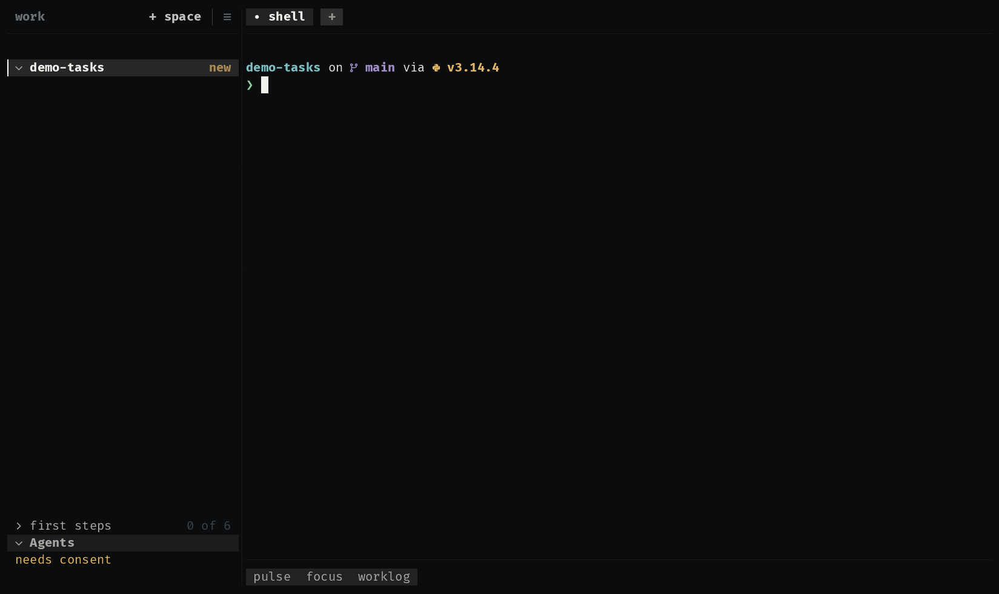

# focus

A pomodoro beside the agent. Its time runs in the bar while the agent
works; when a session ends, a sound and a notification, and the day counts
one more.

  

| Where | What |
|---|---|
| bar | what is left of the session, counting down, or the day's sessions against the goal |
| drawer | a card floating above the timer, as tall as what it holds: what is left in large digits, how far the session is, start and stop (`ctrl+s`, `ctrl+x`), and the last seven days, today's in the warning hue |

**It may:** keep its sessions in UZE's state, one for the machine (`store:global`), so a session goes on whichever project is in front, and
notify you (`notify`). A session's minutes and the day's goal are
preferences.

## How it is built

- [`extension.kdl`](extensions/focus/extension.kdl): a bar item that opens
  a drawer, a source asked every 5 seconds, and two actions that call the
  script.
- [`session.uze`](extensions/focus/session.uze): the drawer's view, and the
  script that keeps the clock in the store and closes a session when its
  time is up.

Try it with the other examples: `/uze:try` in any agent, or `make try` in
a uze checkout.
