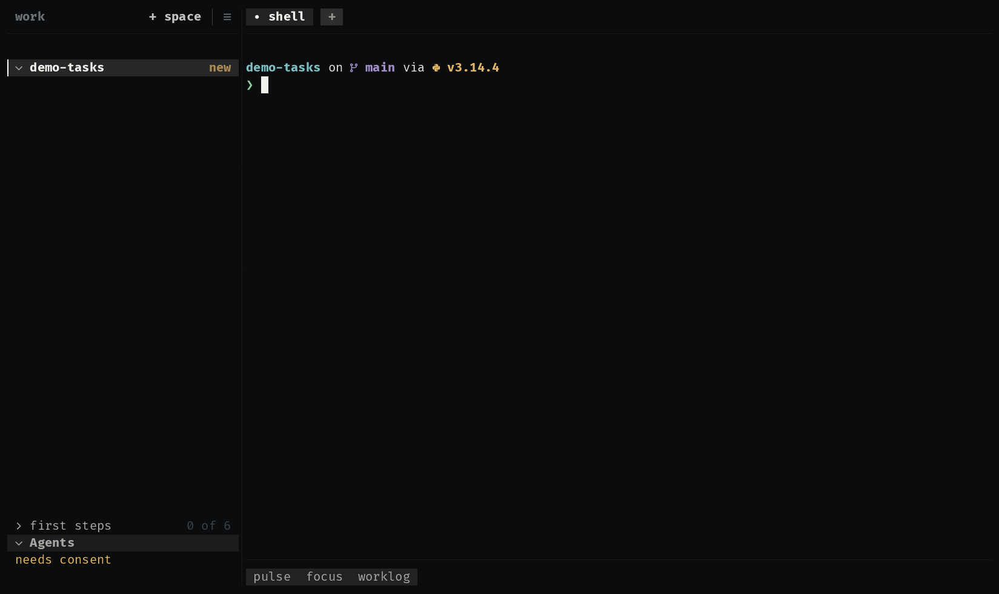

# milestone

A milestone in `.planning/`, beside the agent: how far it has come in the
bar, and its next step one click away. The plugin brings the two skills the
agent plans and executes each phase with, and the extension that shows
where the milestone stands and asks the agent for the next step.

<p align="center">
  
</p>

| Where | What |
|---|---|
| bar | the phases done and the next one: `≡ 1/4 · phase 2` |
| drawer | the next step with its one button (plan or execute), the roadmap, and the phase's plan as the agent wrote it |

The button types `/milestone:plan-phase N` or `/milestone:execute-phase N`
into the agent, after showing you exactly that. The drawer reads
`.planning/` again whenever a file there changes, so it follows the agent
without being asked.

**It may:** read the checkout (`read:checkout`) and type into an agent you
confirm (`agent:prompt`).

## The format

```
.planning/
  STATE.md       Milestone: …, Phase: N, Step: …
  ROADMAP.md     - [ ] **Phase N: name**   ([x] once done)
  phases/NN-name/NN-PLAN.md      once planned
  phases/NN-name/NN-SUMMARY.md   once executed
```

## How it is built

- [`extension.kdl`](extensions/milestone/extension.kdl): a bar item that
  opens a drawer, one source refreshed on `paths.changed`, two actions
  that prompt the agent with a skill.
- [`roadmap.uze`](extensions/milestone/roadmap.uze): the drawer's view, and
  the script that reads `.planning/` with `read_checkout`.
- [`skills/`](skills): what the agent does when the button asks.

Try it with the other examples: `/uze:try` in any agent, or `make try` in
a uze checkout.
