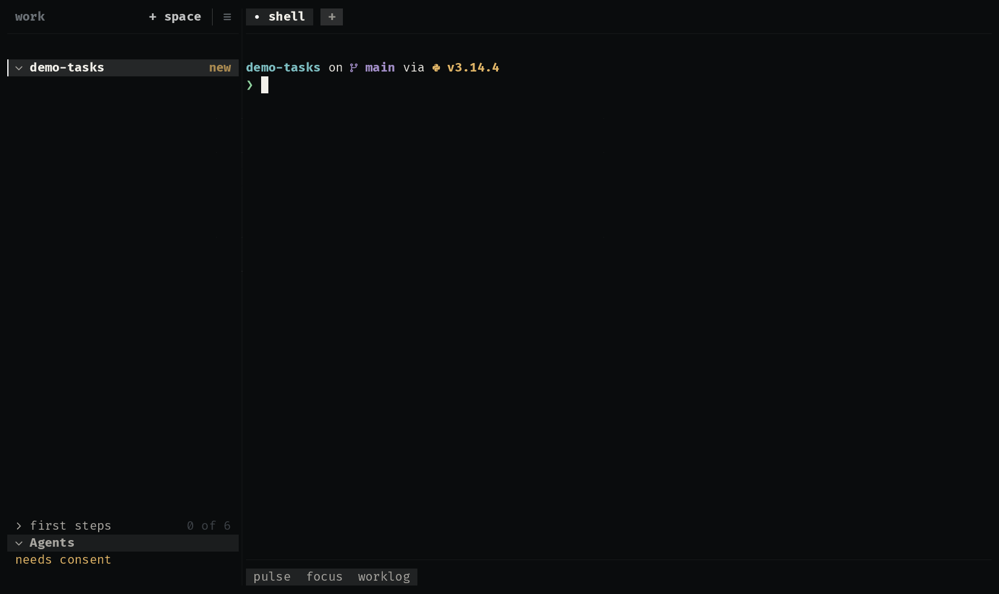

# pulse

The repository's pulse, read from git: today's commits and the last two
weeks in the bar, and a heatmap of the last twelve weeks where every day is
a click away from its commits.

  

| Where | What |
|---|---|
| bar | today's commits and a sparkline of the last 14 days |
| view | the totals, the heatmap, the chosen day's commits and who made them |

Each day's tone is its place among the days that had a commit, so the map
reads the same for a commit a week and for a hundred a day.

**It may:** run `git`, confined (`exec:git`), and remember the chosen day
(`store`).

## How it is built

- [`extension.kdl`](extensions/pulse/extension.kdl): a bar item that opens
  a view, a source refreshed on `checkout.changed`, and an action a click
  on a day calls.
- [`heatmap.uze`](extensions/pulse/heatmap.uze): the view, built on
  `Cells` with a click region per day, and the script that reads one
  `git log`.

Try it with the other examples: `/uze:try` in any agent, or `make try` in
a uze checkout.
