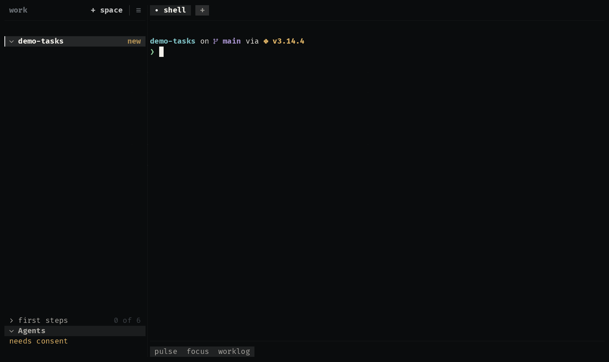

# radar

What the agents are doing: a section listing every agent and how long its
turn has run, and the last events over everything on `alt+r`. A turn that
ends plays a sound, and an agent that asks for approval notifies you, in
the sidebar's notice where a new release shows.

  

| Where | What |
|---|---|
| sidebar, notice | an agent asking for approval, until you put it away |
| sidebar section | every agent: a spinner and its turn's time, or how it stopped |
| overlay, `alt+r` | the last 40 events, newest first: each tool and the file it touched |

**It may:** observe the agents (`agent:observe`) and notify you
(`notify`). The sound and the approval notice are preferences, in the
Extensions screen.

## How it is built

- [`extension.kdl`](extensions/radar/extension.kdl): three surfaces, the
  workspace's own `agents` and `events` sources, and an action that opens
  the overlay from anywhere.
- [`notice.uze`](extensions/radar/notice.uze): a script asked once per
  event (`deliver "each"`), answering the sound and the notification as
  the preferences say. Its status row draws nothing: it stands so the
  source is asked.

Try it with the other examples: `/uze:try` in any agent, or `make try` in
a uze checkout.
