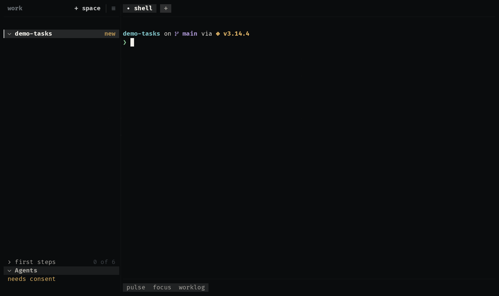

# worklog

Hours logged per working day against a daily goal, in a drawer beside the
agent. The hours come from the plugin's own MCP server, the one the agents
call too: the extension shows what an agent can be asked about.

  

| Where | What |
|---|---|
| bar | the month's hours against what is expected: `131h of 176h 74%` |
| drawer | the month, a card per working day; the latest week; and where the hours went |

Its server, [`mcp/worklog.py`](mcp/worklog.py), makes a month up, the same
on every call, so it works with nothing to connect. A real tracker's MCP
server answering `worklog_month` is the only change a real one needs.

**It may:** call one tool of its MCP server (`mcp:worklog/worklog_month`)
and remember the month on show (`store`). The server runs `python3`, so
installing asks you to trust it.

## How it is built

- [`extension.kdl`](extensions/worklog/extension.kdl): a bar item that
  opens a drawer, a source asked every 30 seconds, and the actions that
  move between months.
- [`panel.uze`](extensions/worklog/panel.uze): the drawer's view, and the
  script that calls the MCP tool and sums the month.

Try it with the other examples: `/uze:try` in any agent, or `make try` in
a uze checkout.
