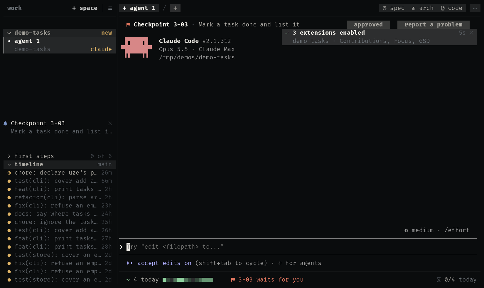

# workspace

uze's own extensions for the workspace, in one package: install it once,
and every extension it carries is listed on the Extensions screen, each
off until you allow what it may reach and enable it. An update that brings
a new one lists it there the same way.

## gsd

[GSD (Get Shit Done)](https://github.com/gsd-build/get-shit-done) beside
the agent: where its milestone stands in `.planning/`, the next step one
click away, and a plan's checkpoint answered over the agent's pane. The
plugin brings no skill of its own: GSD is yours to install, for the
harnesses you run, and the extension reads what it writes and asks the
agent in front for its next step.

<p align="center">
  
</p>

| Where | What |
|---|---|
| bar | the milestone, the phase in front and its step: `◆ v1.4 · 3 plan`; while a checkpoint waits, `3-04 waits for you` |
| drawer | the milestone and how far it is, what waits for you, and every phase on one row: its steps as marks (D P E V: discuss, plan, execute, verify), its plans run and where it stands. The one in front opens to its goal and its plans wave by wave, with the one button for its next step |
| band | over the agent's pane, only while a plan waits at a checkpoint: what to check, `approved` and `report a problem` |

A checkpoint that starts to wait is also a notification, `Checkpoint 3-04`.

**It may:** read the checkout (`read:checkout`), type into an agent you
confirm (`agent:prompt`), notify you (`notify`) and remember which
checkpoint it already told you about (`store`).

### On every harness

GSD's commands are spelled differently on each harness (a slash command
on one, a skill on another), and an extension's prompt may not lead with
any harness's command syntax. So every button types plain words, the same
on Claude Code, Codex, OpenCode and Antigravity, naming the step and its
GSD command:

```
Run GSD's plan-phase step (gsd-plan-phase) for phase 3.
approved
Checkpoint 3-04 is not right: ask me what I saw.
```

`approved` is the answer GSD resumes a checkpoint on. Each one is shown to
you before it is typed, and typed only into an agent that is ready.

### What it reads

```
.planning/
  STATE.md       front matter: milestone, milestone_name, status, stopped_at
  ROADMAP.md     ## Phases, a line per phase: - [ ] **Phase N: name**  ([x] once done)
  phases/NN-name/
    NN-CONTEXT.md                   discussed
    NN-MM-PLAN.md                   planned; front matter wave: N, and
                                    autonomous: false for a plan that stops
                                    at a checkpoint
    NN-MM-SUMMARY.md                that plan executed
    NN-VERIFICATION.md, NN-UAT.md   verified
```

The phase in front is the first not done, at its first step not done. A
checkpoint waits while that phase executes (`status` says so, or
`stopped_at` names a checkpoint) and the first wave with plans left holds
only plans that stop for you: the band names the first of them and its
checkpoint task. The drawer reads `.planning/` again whenever a file there
changes, so it follows the agent without being asked.

The band's row is taken over the agent's pane in every checkout with a
`.planning/`, and stays blank while nothing waits: a band never resizes
the agent's terminal, so a checkpoint appearing never rewraps what the
agent printed.

GSD's workstreams are not shown yet.

### How it is built

- [`extension.kdl`](extensions/gsd/extension.kdl): a bar item that opens a
  docked drawer, a band, one source refreshed on `paths.changed`, and the
  three actions that prompt the agent.
- [`planning.uze`](extensions/gsd/planning.uze): the script that reads
  `.planning/` with `read_checkout`, and notifies a checkpoint once.
- [`bar.uze`](extensions/gsd/bar.uze), [`drawer.uze`](extensions/gsd/drawer.uze),
  [`band.uze`](extensions/gsd/band.uze): what each surface draws.

## focus

A pomodoro beside the agent. Its time runs in the bar while the agent
works; when a session ends, a sound and a notification, and the day counts
one more.

<p align="center">
  
</p>

| Where | What |
|---|---|
| bar | what is left of the session, counting down, or the day's sessions against the goal |
| drawer | a card floating above the timer, as tall as what it holds: what is left in large digits, how far the session is, start and stop (`ctrl+s`, `ctrl+x`), and the last seven days, today's in the warning hue |

**It may:** keep its sessions in UZE's state, one for the machine (`store:global`), so a session goes on whichever project is in front, and
notify you (`notify`). A session's minutes and the day's goal are
preferences.

### How it is built

- [`extension.kdl`](extensions/focus/extension.kdl): a bar item that opens
  a drawer, a source asked every 5 seconds, and two actions that call the
  script.
- [`session.uze`](extensions/focus/session.uze): the drawer's view, and the
  script that keeps the clock in the store and closes a session when its
  time is up.

## contributions

A minimal contribution graph of the repository, as GitHub and GitLab draw
one, read from git: today's commits and the last two
weeks in the bar, and a map of the last twenty weeks where every day is a
click away from its commits.

<p align="center">
  
</p>

| Where | What |
|---|---|
| bar | today's commits and the last 14 days in the map's tones |
| drawer | floating along the bottom, over the agent: the commits, active days and streaks, the map with its months and weekdays, the chosen day's commits and who made them |

Each day's tone is one of the theme's five heat steps (`heat-0` to
`heat-4`), by the day's place among the days that had a commit, so the map
reads the same for a commit a week and for a hundred a day.

**It may:** run `git`, confined (`exec:git`), and remember the chosen day
(`store`).

### How it is built

- [`extension.kdl`](extensions/contributions/extension.kdl): a bar item that opens
  a floating drawer, a source refreshed on `checkout.changed`, and an action a click
  on a day calls.
- [`heatmap.uze`](extensions/contributions/heatmap.uze): the drawer's view, built on
  `Cells` with a click region per day, and the script that reads one
  `git log`.
- [`today.uze`](extensions/contributions/today.uze): the bar's line.

Try them: `/uze:try` in any agent, or `make try` in a uze checkout.
