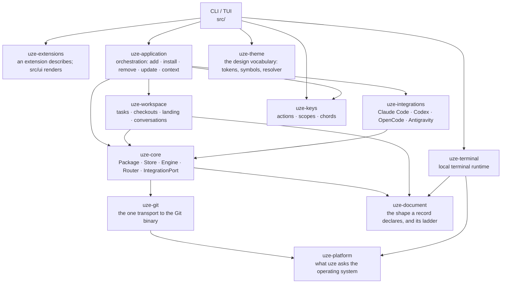

Dependency direction is one-way and enforced by tests, not just convention. Both
orchestration and the vendor adapters depend on the neutral core, never the
reverse:

`uze-platform` sits under every crate that talks to the operating system and is
drawn only where it explains a boundary.

- **`uze-core` never names a harness.** No Claude, Codex, OpenCode, or Antigravity
  string in production code, enforced by `core_never_names_a_vendor_harness`; the
  same neutrality holds for `uze-application` and the CLI/TUI.
- **`uze-integrations` is the only vendor-specific layer.** One module per harness
  implementing the shared `IntegrationPort`; its `registry` is the single
  composition root. A new harness should require no semantic change to Store,
  Engine, or Router: only a new integration vertical, one registry entry,
  conformance, and docs.
- **Presentation never reaches into the domain.** `src/` may not name `uze_core`
  or `uze_integrations`; it consumes read models from `uze-application`. The debt
  is zero, and the budget is never raised (ADR-042).
- **Antigravity is the Google-family v0 harness** (ADR-027); the four supported
  harnesses are the current set. Planned: Cursor CLI, Muse, PI.

## The supporting crates

- **`uze-git`**: the one transport for speaking to the Git binary: spawn
  convention, `read`/`write` entry points, and Git's exit code reported rather
  than classified. It carries no domain, and nothing else in the workspace spawns
  `git` directly; two callers with two exit-code conventions is exactly what it
  replaced.
- **`uze-terminal`**: the local terminal runtime: a server owning the
  pseudoterminals and a versioned client protocol, so a pane survives the client
  leaving (ADR-038). It depends on nothing else in the workspace but
  `uze-platform` and `uze-document`, whose rule it obeys like everything else
  that persists.
- **`uze-theme`**: the design vocabulary: colour `Token`s, named `Symbol`s, the
  theme file schema, and the resolver that completes a partial theme from the
  built-in default. A leaf crate that resolves no path, reads no environment and
  names no rendering library, so every consumer adapts its `Rgb` to what it draws
  with. **Nothing outside `src/ui/theme.rs` may name a colour value or write a
  chrome glyph inline**: two architecture rules fail the build over it. See
  [Appearance](/docs/workspace/appearance).
- **`uze-extensions`**: built-in TUI extensions. An extension answers with a
  view or a section and **never draws**: the host owns rendering, geometry,
  hit-testing and the palette, and every other capability (running Git, reading a
  file, resolving `$HOME`) arrives through a `Host` it is handed. The crate
  depends on no uze crate at all and names no process, filesystem or environment
  API, since an extension is code uze runs in its own process, a different trust class
  from plugin bytes a harness reads (ADR-041). Three ship today:
  [Spec, Architect and Code](/docs/workspace#extensions).
- **`uze-document`**: the one rule for reading a record another build wrote: the
  shape a record declares, the ladder that carries it across a version, and the
  floor beneath that. A record written in a shape this build knows is carried
  across silently; only a shape with no rung is set aside, and a record from a
  *newer* build is never taken. A leaf crate naming no domain, no path and no
  harness: a durability rule written in two places is the failure it exists to
  end.
- **`uze-workspace`**: the workspace's domain: the agents uze launches, their
  checkouts, the conversation each is in, how finished work lands, and what
  `agents.yaml`'s `workspace:` section declares. Built on `uze-core`, and never
  depended on by it: the package manager works without the workspace, and the
  compiler is what says so.
- **`uze-platform`**: what uze asks the operating system, answered once per
  platform: processes and their trees, cross-process locks, the shell an
  authored line runs in (`sh -c`, or Windows PowerShell 5.1), paths, private
  files, and the image a running binary is replaced by. One concept per module
  and one implementation per platform, so nothing that uses it branches on the
  operating system.
- **`uze-keys`**: actions, scopes and chords: the vocabulary
  [Shortcuts](/docs/workspace/keys) is written in, and the resolver that answers which
  action a chord reaches in the surface that is open.

## Repository layout

A path and what lives there. The crate boundaries above are the load-bearing
part; everything else is where to look.

| Path | What lives there |
| --- | --- |
| `crates/uze-core` | The harness-agnostic domain: package, store, engine, router, `IntegrationPort` |
| `crates/uze-application` | Orchestration: add, install, remove, update, context |
| `crates/uze-workspace` | The workspace's domain: tasks, checkouts, landing, conversations |
| `crates/uze-integrations` | The vendor adapters, one module per harness |
| `crates/uze-extensions` | Built-in TUI extensions |
| `crates/uze-terminal` | The local terminal runtime |
| `crates/uze-git` | The one transport to the Git binary |
| `crates/uze-theme` | Colour tokens, symbols, and the theme resolver |
| `crates/uze-document` | The shape a record declares, and the ladder that carries it across a version |
| `crates/uze-keys` | Actions, scopes, chords, and the keymap that resolves them |
| `crates/uze-platform` | Processes, locks, shells, paths and files, one implementation per operating system |
| `crates/uze-testkit` | Shared test infrastructure |
| `src/` | The CLI, the TUI, and the runtime PATH shim |
| `tests/` | Integration suites, L0–L4 (see `tests/README.md`) |
| `journeys/` | Product journeys: a user's flow, checked against the machine it left behind |
| `conformance/` | The Harness Conformance Lab |
| `docs/adr/` | Numbered decision records |
| `docs/architecture/` | The architecture as Mermaid diagrams, and the invariants that hold today, each tied to its test |
| `openspec/` | Change proposals, active and archived |
| `plugins/uze/` | The official uze plugin |

## Invariants

`docs/architecture/invariants.md` in the repository is the canonical list of "do
not break this" behaviors, each tied to the test that proves it. Among them:

- the Store is the single source of truth and writes nothing a harness reads;
- receipts drive lifecycle safety, and derived artifacts are rebuildable;
- the runtime shim never recurses into itself;
- nothing the workspace client draws waits on a repository: every Git read runs
  on a thread and answers through a channel, and an answer that arrives after the
  viewer moved on is dropped rather than drawn;
- every CLI leaf command is performance-classified.

Design decisions with their rationale live in `docs/adr/`; recent ones cover
what uze persists and why each tier is where it is, isolation belonging to the
agent rather than the space, a project's commands running only once the
operator approved them, and the terminal runtime serving the person rather than
the panes.
